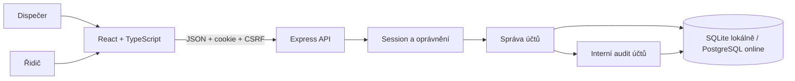

# Architektura Foresteru

Říjnová verze podle uživatelova zadání: databázový návrh, přihlášení a odhlášení, role, deaktivace, správa účtů a základ UI/UX. Jedna instalace pro jednu firmu, české rozhraní.

## Technologie a spuštění

Frontend používá React 19, TypeScript, Vite a sdílené CSS. Backend běží na Node 24.11+ v řadě 24.x s Express 5, vstupy ověřuje Zod. Lokální databázi zajišťuje vestavěné `node:sqlite`; online API používá PostgreSQL přes `pg`. Aplikace používá parametrizované SQL dotazy a asynchronní databázovou vrstvu `server/store.ts`.

`npm.cmd run dev` spouští frontend na `127.0.0.1:5173` a API na `127.0.0.1:3001`. Vite předává `/api` backendu. `npm.cmd run build` ověří TypeScript a sestaví frontend; `npm.cmd start` servíruje sestavenou aplikaci i API z portu 3001.

## Data a migrace

Data jsou v `data/forester.sqlite`, cestu mění `DATABASE_PATH`. Při otevření databáze se provedou dosud neaplikované SQL migrace. Zapnuté jsou cizí klíče, WAL a timeout při souběhu zápisů. Změny účtů a jejich audit se ukládají v jedné transakci.

Při nastaveném `DATABASE_URL` se API připojuje k PostgreSQL. Na Vercelu běží přes `api/index.ts` s poolovaným připojením; frontend a API používají stejnou doménu. `npm run vercel:build` provede PostgreSQL migrace a inicializaci prvního dispečera před sestavením frontendu. Samostatné migrace v `server/postgres-migrations` zachovávají datový model, cizí klíče a odpovídající triggery; číselná pole jsou `BIGINT`. PostgreSQL navíc obsahuje technickou tabulku `login_attempts`. Zápisy účtů používají transakční advisory lock, aby souběžné instance nevytvořily stejný kód zaměstnance nebo neodebraly posledního dispečera. Postup připojení je v [vercel.md](vercel.md).

`users` obsahuje přihlašovací údaje, roli a aktivitu. `employees` představuje profil zaměstnance; řidičský účet musí mít profil a jeden profil má nejvýše jeden účet. `sessions` uchovává přihlášení. Databázový model dalších domén je zachovaný jako výsledek návrhu databáze, tyto domény nejsou vystavené v říjnové aplikaci.

Při vytvoření řidičského účtu lze vybrat volný aktivní profil nebo zadat jméno a příjmení nového zaměstnance. `POST /api/users` přijímá buď `employeeId`, nebo `newEmployee` s poli `firstName` a `lastName`. Server novému profilu přidělí UUID a další volný kód `ZAM-…`. Profil, účet a oba auditní záznamy vznikají v jedné transakci po opětovném ověření dispečerské role; při chybě se vše vrátí zpět. Nejde o samostatný modul správy zaměstnanců.

## Přihlášení a oprávnění

Hesla se ukládají jako scrypt hash s náhodnou solí. Session používá náhodný token, jeho SHA-256 hash je v DB a token v HttpOnly/SameSite=Strict cookie. Výchozí platnost přihlášení je 12 hodin. Zápisy vyžadují povolený Origin a session CSRF token. Neznámý účet a chybné heslo vracejí stejnou chybu. Chybné přihlášení je omezené na 10 pokusů z IP během 15 minut: v lokální SQLite variantě je limit v paměti procesu, na PostgreSQL v tabulce `login_attempts`, sdílené mezi instancemi. Ukládá se hash IP a čas expirace.

Server ověřuje session a aktivitu uživatele u každého chráněného požadavku. Deaktivace, úprava účtu nebo reset hesla zneplatní dosavadní session. Povinná změna dočasného hesla blokuje ostatní akce do jejího dokončení. Po asynchronním hashování se zápis znovu autorizuje uvnitř transakce.

Dispečer vytváří a upravuje účty a přiřazuje role. Poslední aktivní dispečer musí zůstat zachovaný. Pole `version` brání přepsání změny zastaralým formulářem. Username se normalizuje stejně při vytvoření i úpravě a unikátnost hlídá DB.

## Rozhraní a API

Navigace dispečera obsahuje Úvod a Účty a oprávnění. Řidič má pouze Úvod s údaji svého účtu. Obě role mají odhlášení a přepnutí tématu. Samostatný profil není v navigaci; komponenta změny hesla se používá při povinné změně dočasného hesla.

`GET /api/bootstrap` vrací účet, CSRF token, demo příznak a čas načtení. Dispečer dostane navíc seznam profilů zaměstnanců pro správu účtů. Řidiči se nevracejí provozní data ani seznam zaměstnanců.

Veřejně dostupná je kontrola zdraví a přihlášení. Chráněné API obsahuje bootstrap, odhlášení, změnu vlastního hesla a správu účtů včetně resetu hesla. Správa účtů vyžaduje roli dispečera.

Provozní endpointy rezervací, zakázek a auditu jsou odstraněné a vracejí 404. Staré adresy obrazovek práce, techniky, plánování a auditu se nerozpoznávají jako aktivní stránky. Přímý přístup řidiče na správu účtů odmítá UI i server.

## Interní audit a ověření

Změny účtů a přihlášení se zapisují do `audit_events`; hesla, hashe a tokeny se nezapisují. Audit nemá v říjnové aplikaci vlastní obrazovku ani čtecí API. SQL triggery brání běžné změně a smazání auditních záznamů.

Interní doménová služba rezervací a její testy zůstávají v repozitáři, v aplikaci ji nelze vyvolat. Databáze se při zúžení rozsahu nemaže a existující data zůstávají zachovaná.

Testy pokrývají identity, role, editaci, deaktivaci, integritu databáze a nedostupnost provozních API. Stav vizuálního QA je v `docs/overeni.md`. Externí hosting nebyl ověřen; produkční režim vyžaduje HTTPS a databázi bez demo dat.
