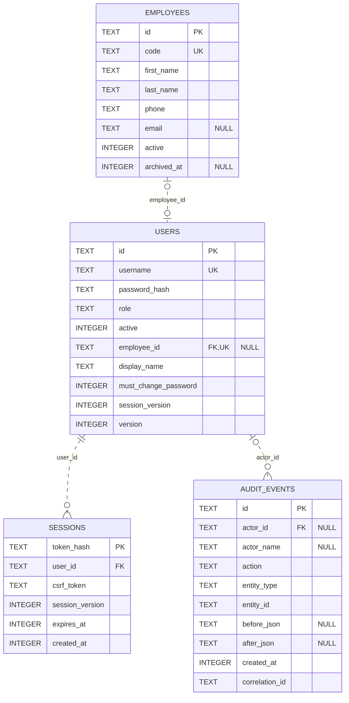
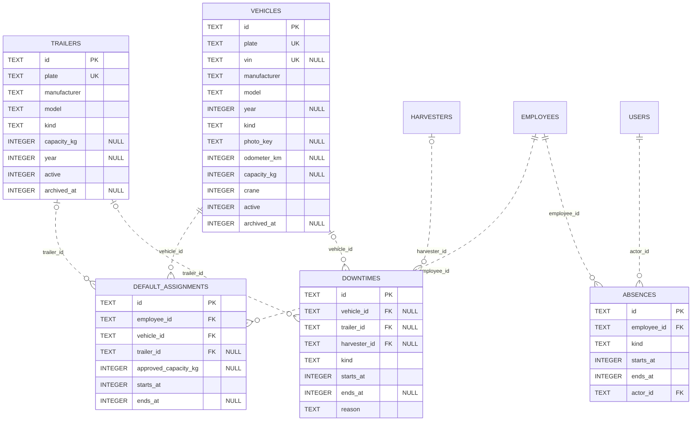
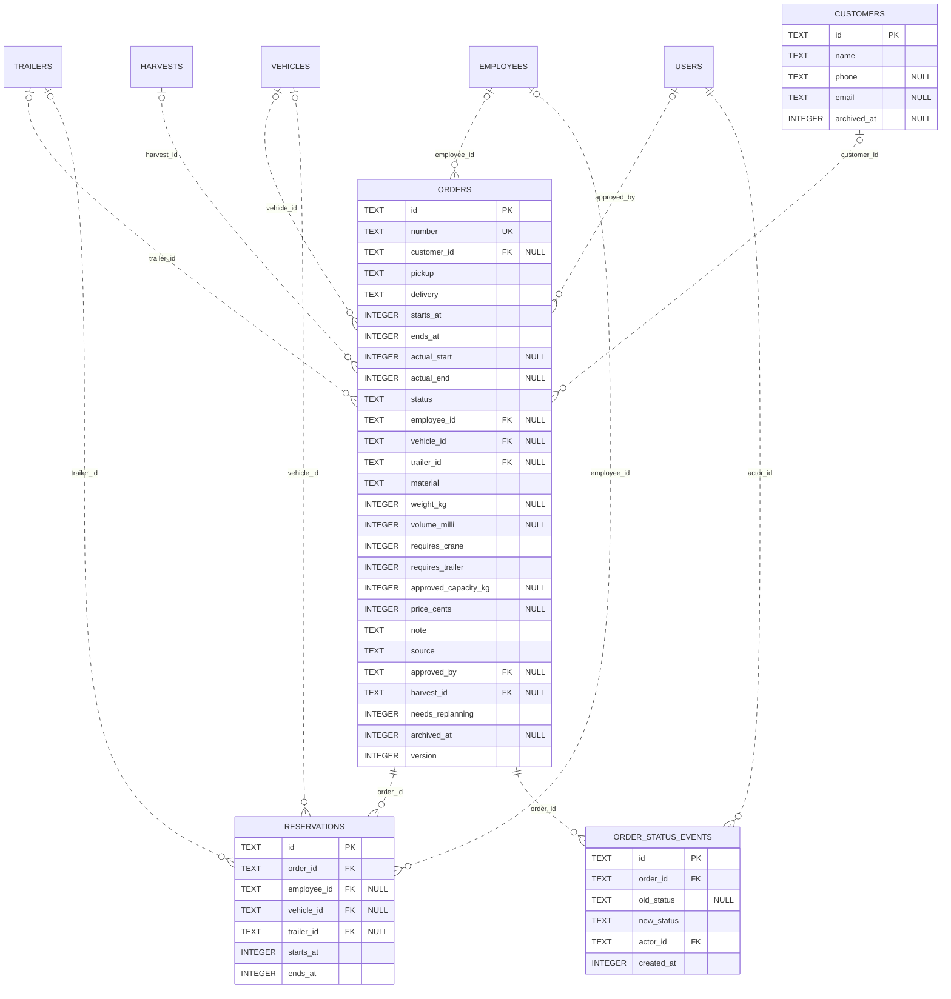
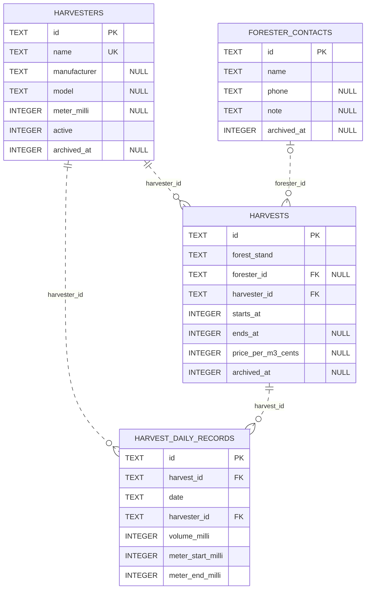
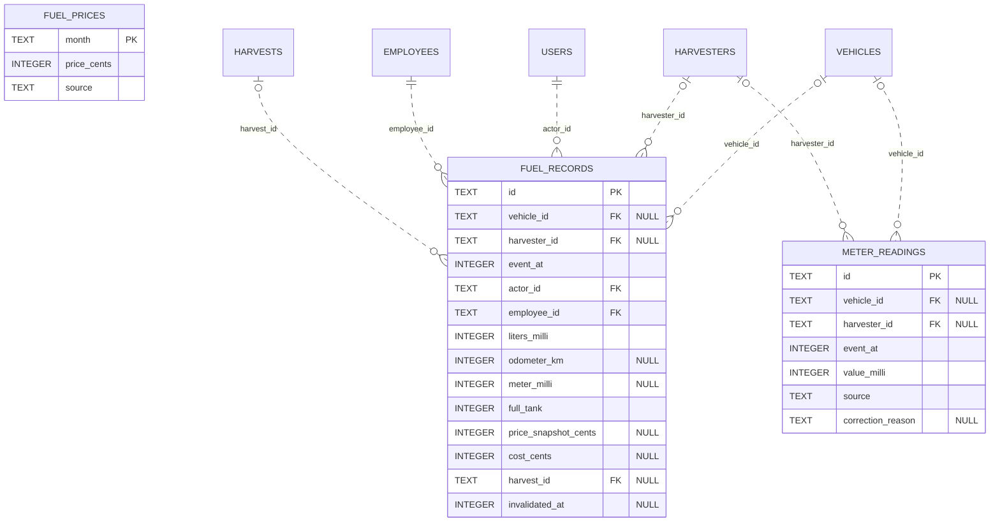
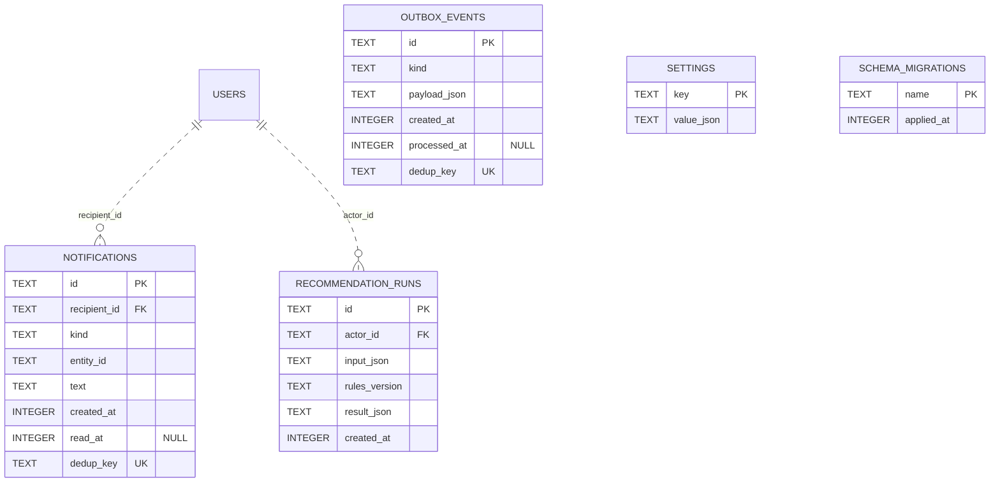

# Datový model a ERD databáze Forester

ERD odpovídá aktuálnímu schématu SQLite: [001-foundation.sql](../server/migrations/001-foundation.sql), [002-order-integrity.sql](../server/migrations/002-order-integrity.sql) a technické tabulce migrací v [server/db.ts](../server/db.ts). Obsahuje všech 27 tabulek, jejich sloupce, klíče a všechny skutečné FK vazby.

V říjnové aplikaci jsou dostupné identity a správa účtů podle [říjnového zadání](rijnove-zadani.md). Ostatní provozní tabulky již existují v databázi jako základ dalšího vývoje, ale nemají dostupné provozní API ani obrazovky. Finanční entity `FinancialEntry` a `CostAllocation` jsou pouze budoucí návrh pro rozšířenou verzi R a nejsou součástí tohoto ERD.

## Jak diagram číst

Diagramy jsou ve formátu Mermaid. Ve VS Code otevři náhled Markdownu pomocí **Ctrl+Shift+V**; pokud se zobrazuje jen kód, použij náhled s podporou Mermaid.

| Značka                    | Význam                                              |
| ------------------------- | --------------------------------------------------- |
| PK                        | Primární klíč                                       |
| FK                        | Cizí klíč                                           |
| UK                        | Samostatně unikátní sloupec                         |
| NULL                      | Sloupec dovoluje neznámou nebo nevyplněnou hodnotu  |
| <code>&#124;&#124;</code> | Právě jeden záznam                                  |
| <code>o&#124;</code>      | Nula nebo jeden záznam                              |
| `o{`                      | Nula až mnoho záznamů                               |
| `..`                      | Neidentifikující vazba: FK není součástí PK potomka |

Názvy a typy sloupců odpovídají SQL. Logické hodnoty jsou v SQLite uložené jako `INTEGER`. Popisek vazby uvádí název FK sloupce v potomkovi. Tabulka bez vypsaných sloupců je odkaz na její úplný popis v jiném diagramu. Složená unikátní omezení a podmíněná pravidla jsou uvedena pod diagramy.

## 1. Účty, zaměstnanci a přihlášení

Aktivní říjnový základ: profily zaměstnanců, správa účtů, serverové přihlášení a interní audit. Vazba zaměstnance na účet je volitelná na obou stranách; role `driver` však profil zaměstnance vyžaduje. Audit může mít neznámého nebo systémového autora (`actor_id = NULL`).

## 2. Technika, soupravy a dostupnost

Běžné přiřazení soupravy propojuje zaměstnance a tahač, volitelně návěs. Nepřítomnost patří zaměstnanci a má autora. Odstávka se vztahuje právě k jednomu tahači, návěsu nebo harvestoru.

## 3. Zákazníci, zakázky a rezervace

Zakázka může být propojena se zákazníkem a těžbou. Řidič, tahač, návěs i schvalující účet mají nullable FK; povinné obsazení závisí na stavu zakázky a požadavku na návěs. Každá rezervace blokuje právě jeden prostředek.

## 4. Těžba a denní výkony

Těžba má povinný harvestor a volitelný kontakt na hajného. Denní výkon odkazuje na těžbu i konkrétní harvestor. Odvoz ze těžby je propojen přes `orders.harvest_id` v diagramu zakázek.

## 5. Tankování, ceny a odečty

Tankování i odečet patří právě jednomu tahači nebo harvestoru. Tankování má autora, zaměstnance a volitelnou těžbu. `fuel_prices` je samostatný měsíční ceník bez cizího klíče do tankování; uložená cena `price_snapshot_cents` zachovává historickou cenu.

## 6. Servis a servisní intervaly

Servisní záznam i servisní plán patří právě jednomu tahači, návěsu nebo harvestoru. Plán může odkazovat na poslední provedený servis; shodu jeho prostředku s prostředkem servisního záznamu samotný FK nekontroluje.

```mermaid
erDiagram
    USERS ||..o{ SERVICE_RECORDS : "actor_id"
    HARVESTERS o|..o{ SERVICE_RECORDS : "harvester_id"
    TRAILERS o|..o{ SERVICE_RECORDS : "trailer_id"
    VEHICLES o|..o{ SERVICE_RECORDS : "vehicle_id"
    SERVICE_RECORDS {
        TEXT id PK
        TEXT vehicle_id FK "NULL"
        TEXT trailer_id FK "NULL"
        TEXT harvester_id FK "NULL"
        INTEGER event_at
        TEXT kind
        TEXT description
        INTEGER cost_cents "NULL"
        INTEGER meter_milli "NULL"
        TEXT provider "NULL"
        TEXT actor_id FK
    }
    SERVICE_RECORDS o|..o{ SERVICE_SCHEDULES : "last_service_id"
    HARVESTERS o|..o{ SERVICE_SCHEDULES : "harvester_id"
    TRAILERS o|..o{ SERVICE_SCHEDULES : "trailer_id"
    VEHICLES o|..o{ SERVICE_SCHEDULES : "vehicle_id"
    SERVICE_SCHEDULES {
        TEXT id PK
        TEXT vehicle_id FK "NULL"
        TEXT trailer_id FK "NULL"
        TEXT harvester_id FK "NULL"
        TEXT kind
        TEXT last_service_id FK "NULL"
        INTEGER interval_milli "NULL"
        INTEGER next_meter_milli "NULL"
        INTEGER next_date "NULL"
        INTEGER warning_milli "NULL"
    }
```

## 7. Oznámení a systémové tabulky

Oznámení má příjemce a běh doporučení autora. `outbox_events` uchovává události k doručení, `settings` konfiguraci a `schema_migrations` evidenci provedených migrací. Poslední tabulku vytváří `server/db.ts`.

## Datový slovník a pravidla integrity

| Oblast                  | Pravidlo                                                                                                                                                                                        |
| ----------------------- | ----------------------------------------------------------------------------------------------------------------------------------------------------------------------------------------------- |
| Identifikátory          | Nové záznamy aplikace používají UUID v `TEXT`; demo má stabilní ID. Výjimky PK: `sessions.token_hash`, `fuel_prices.month`, `settings.key`, `schema_migrations.name`.                           |
| Účet a zaměstnanec      | `users.employee_id` je volitelný a unikátní. DB CHECK vyžaduje profil pro roli `driver`; role jsou `dispatcher` a `driver`.                                                                     |
| Přihlašovací jméno      | DB zaručuje unikátnost. Aplikace navíc provádí trim, převod na malá písmena a validaci 3–40 znaků `a-z0-9._-`.                                                                                  |
| Jedinečné údaje         | Samostatné UK jsou vyznačeny v diagramech, včetně kódu zaměstnance, SPZ, VIN a čísla zakázky. Volitelné UK mohou mít více hodnot `NULL`.                                                        |
| Rezervace: složené UK   | `UNIQUE(order_id, employee_id)`, `UNIQUE(order_id, vehicle_id)`, `UNIQUE(order_id, trailer_id)`. Na řádku je právě jeden nenulový FK prostředku.                                                |
| Denní výkon: složené UK | `UNIQUE(harvest_id, date, harvester_id)`. Konečný stav MTH nesmí být nižší než počáteční.                                                                                                       |
| Právě jeden stroj       | Odstávka, servis a servisní plán vyžadují právě jeden z `vehicle_id`, `trailer_id`, `harvester_id`. Tankování a odečet právě jeden z `vehicle_id`, `harvester_id`. Hlídají SQL CHECK.           |
| Stav zakázky            | `waiting`, `planned`, `in_progress`, `completed`, `cancelled`. Kromě `waiting` a `cancelled` DB vyžaduje řidiče a tahač, při `requires_trailer != 0` i návěs.                                   |
| Rezervace: konzistence  | INSERT trigger vyžaduje stav zakázky `planned` nebo `in_progress`, shodný interval a shodný přiřazený prostředek. Další trigger brání časovému překryvu stejného prostředku.                    |
| Přeplánování            | Rezervace nelze upravovat přes UPDATE. Migrace 002 vyžaduje nejprve atomicky uvolnit rezervace před změnou rezervovaných polí nebo ukončením zakázky.                                           |
| Časy a intervaly        | Časové okamžiky jsou `INTEGER` v milisekundách od Unix epochy (UTC). Intervaly používají `[starts_at, ends_at)`; konec musí být po začátku. U soupravy, těžby a odstávky může být konec `NULL`. |
| Kalendářní údaje        | `harvest_daily_records.date` je textové datum, `fuel_prices.month` textový měsíc; nejsou to časové okamžiky v epoch ms.                                                                         |
| Jednotky                | `*_cents` = haléře CZK, `*_kg` = kg, `*_milli` = tisíciny jednotky (l, m³, MTH; u odečtů a servisu podle typu prostředku). `odometer_km` = celé km. `NULL` se liší od nuly.                     |
| Kapacita soupravy       | `approved_capacity_kg` je samostatná schválená kapacita celé soupravy; nejde o prostý součet nosností.                                                                                          |
| Cena paliva             | Tankování ukládá vlastní cenovou kopii. Změna měsíčního ceníku sama nepřepisuje historické tankování; mezi ceníkem a tankováním není FK.                                                        |
| Archiv                  | `archived_at` uchovává čas archivace. FK zachovávají vazby historie; schéma nedefinuje kaskádové mazání.                                                                                        |
| Audit                   | `actor_id` může být `NULL`. Triggery zakazují UPDATE a DELETE auditu; obchodní zápis a jeho audit aplikace ukládá v jedné transakci.                                                            |
| Obecné odkazy           | `audit_events.entity_id` a `notifications.entity_id` nejsou FK. Cílová entita se určuje kontextem typu události, proto nemají zakreslené relační vazby. Totéž platí pro ID uvnitř JSON.         |
| Souběh                  | `users.version` a `orders.version` slouží pro kontrolu zastaralých změn; aplikace používá `BEGIN IMMEDIATE`. `session_version` umožňuje zneplatnit přihlášení.                                  |

Samotné schéma ještě nezajišťuje kompletní provozní workflow. Budoucí doménové služby musí doplnit například kontrolu klesajícího tachometru/MTH napříč záznamy, povolené přechody stavů zakázek, označování plánů k přeplánování a finanční výpočty.
